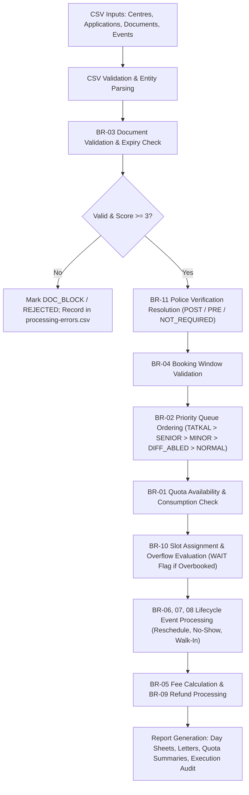

# PS-117 — Design Document
## Passport and Visa Appointment Slot Allocation Engine with Priority Categories and Document Checks

---

## 1. Executive Summary & Problem Statement

The **PS-117 Slot Allocation Engine** is a deterministic, rule-driven appointment management system designed for passport and consular service centres. The engine processes high-volume applicant queues, enforces rigorous document checklists, calculates service fees and refunds, classifies priority tiers, enforces capacity quotas with dynamic release schedules, and handles lifecycle events (cancellations, reschedules, no-shows, and walk-ins).

### Key Architectural Tenets
1. **Determinism**: Identical inputs and `--as-of` operational timestamps guarantee 100% reproducible slot assignments, quota deductions, and financial calculations.
2. **Separation of Concerns**: Document verification, priority ranking, quota management, slot allocation, lifecycle events, and billing are isolated into distinct, loosely-coupled domain services.
3. **Immutability & Auditability**: All applicant status changes, quota movements, and monetary transactions generate explicit audit records with precise timestamps.
4. **Precision**: All financial calculations use `java.math.BigDecimal` with `RoundingMode.HALF_UP` to prevent floating-point inaccuracies.

---

## 2. System Architecture

The engine adheres to a clean, multi-layered architecture:

```
+-----------------------------------------------------------------------------------+
|                              CLI Application Layer                                |
|    (PassportSlotEngine / CliCommandDispatcher / Command-Specific Workflows)       |
+-----------------------------------------------------------------------------------+
        |                      |                      |                      |
        v                      v                      v                      v
+----------------+     +----------------+     +----------------+     +----------------+
| Validation     |     | Allocation     |     | Lifecycle      |     | Billing        |
| Layer          |     | Layer          |     | Layer          |     | Layer          |
| - Checklist    |     | - Priority     |     | - Reschedule   |     | - FeeCalc      |
| - DocValidator |     | - QuotaManager |     | - Cancellation |     | - RefundCalc   |
| - ModeResolver |     | - Engine       |     | - NoShow       |     |                |
| - BookingWin   |     | - SlotCapacity |     | - WalkIn       |     |                |
+----------------+     +----------------+     +----------------+     +----------------+
        |                      |                      |                      |
        +----------------------+----------------------+----------------------+
                                       |
                                       v
+-----------------------------------------------------------------------------------+
|                                 Domain Model                                      |
|    (Application, Document, Centre, Slot, QuotaAllocation, Event, Appointment)    |
+-----------------------------------------------------------------------------------+
                                       |
                                       v
+-----------------------------------------------------------------------------------+
|                           Infrastructure & Reporting                              |
|           (CsvReader, CsvWriter, CentreDaySheetReport, QuotaReport)               |
+-----------------------------------------------------------------------------------+
```

### Module Responsibilities
- **CLI Layer (`com.ps117.app`, `com.ps117.cli`)**: Parses command-line arguments, validates execution modes (`PROCESS`, `VALIDATE`, `ALLOCATE`, `QUOTA-REPORT`, `FEE-REPORT`, `DAY-SHEET`, `EVENT-PROCESS`), loads configurations, and invokes designated pipeline handlers.
- **Validation Layer (`com.ps117.validation`)**: Implements BR-03 (Document Checklist), BR-04 (Booking Window Validation), BR-11 (Police Verification Mode Selection), and document expiration logic.
- **Allocation Layer (`com.ps117.allocation`)**: Orchestrates BR-01 (Slot Structure & Quota Formulas), BR-02 (Priority Queue Sorting), and BR-10 (Overbooking / Overflow Flagging).
- **Lifecycle Layer (`com.ps117.lifecycle`)**: Implements BR-06 (Rescheduling Rules), BR-07 (No-Show State Transitions), and BR-08 (Walk-In Quotas).
- **Billing Layer (`com.ps117.billing`)**: Executes BR-05 (Fee Calculation & Concessions) and BR-09 (Cancellation & Refund Schedules).
- **Reporting & Infrastructure Layer (`com.ps117.reporting`, `com.ps117.io`)**: Serializes allocation summaries, day sheets, appointment letters, quota matrices, and CSV results.

---

## 3. End-to-End Data Flow



---

## 4. Official Business Rules Specification (BR-01 through BR-12)

### BR-01: Slot Structure & Daily Quotas
- **Operating Hours**: Centres operate Monday to Friday from 09:00 to 16:00.
- **Slot Granularity**: 15-minute slot intervals, yielding 28 distinct time slots per counter per operating day.
- **Daily Quota Pools** (calculated against total daily centre capacity):
  - **TATKAL**: $\lfloor 20\% \times \text{Daily Capacity} \rfloor$ (e.g., 28 capacity $\rightarrow$ 5 slots).
  - **SENIOR_CITIZEN & MINOR**: $\lfloor 15\% \times \text{Daily Capacity} \rfloor$ (e.g., 28 capacity $\rightarrow$ 4 slots).
  - **PCC (Police Clearance Certificate)**: $\lfloor 10\% \times \text{Daily Capacity} \rfloor$ (e.g., 28 capacity $\rightarrow$ 2 slots).
  - **NORMAL**: Remainder $= \text{Daily Capacity} - (\text{TATKAL} + \text{SENIOR\_MINOR} + \text{PCC})$ (e.g., 28 capacity $\rightarrow$ 17 slots).
- **Quota Release Mechanism**:
  - Unused capacity in non-TATKAL pools (`SENIOR_MINOR`, `PCC`) is automatically released at **17:00 two working days before the appointment date** ($T-2$ days) into the `RELEASED` pool.
  - **Strict Invariant**: TATKAL quota is **never** released under any circumstances.
  - Released capacity becomes accessible to all eligible applicants once primary quota pools are exhausted.

### BR-02: Priority Categories & Queue Precedence
Applicants are assigned priority ranks based on category, with age strictly evaluated as of the **appointment date**:
1. **Rank 1 — TATKAL**: Urgent applications with verified biometric/identity credentials.
2. **Rank 2 — SENIOR_CITIZEN**: Applicants aged 60 years or older on the appointment date ($\text{Age} \ge 60$).
3. **Rank 3 — MINOR**: Applicants under 18 years of age on the appointment date ($\text{Age} < 18$).
4. **Rank 4 — DIFFERENTLY_ABLED**: Applicants possessing certified disability documentation.
5. **Rank 5 — NORMAL**: Standard applicants not meeting the criteria above.

- **Tie-Breaking Rule**: Within the same priority category, ordering is strictly determined by FIFO application timestamp (`application_date` ascending, followed by `application_id` ascending).
- **Third Reschedule Penalty**: An applicant undergoing their third reschedule is demoted to the back of their priority tier (`thirdRescheduleMovedToBack = true`).

### BR-03: Document Checklist & Validation
Validation requires verifying both mandatory document presence and document validity dates:
- **Validity Invariant**: A document is valid through its expiration date (`valid_until`). It is expired **only if** `valid_until.isBefore(appointmentDate)`. A document expiring on the appointment date itself is valid (Edge Case 4).
- **Mandatory Requirements Matrix**:
  - `FRESH_PASSPORT`: Must provide Address Proof (`AADHAAR`, `UTILITY_BILL`, or `BANK_PASSBOOK`), DOB Proof (`BIRTH_CERTIFICATE` or `AADHAAR`), and `PHOTO`.
  - `RE_ISSUE`: Must provide `OLD_PASSPORT` and `PHOTO`. If address has changed, Address Proof is also mandatory.
  - `TATKAL`: In addition to service proofs, must provide `AADHAAR` in **`VERIFIED`** status.
  - `MINOR`: Must provide DOB Proof, Parent Consent (`PARENT_PASSPORT` or `ANNEXURE_D`), and `PHOTO`.
  - `PCC`: Must provide `PASSPORT_COPY` and Address Proof.
- **Scoring System**:
  - `VERIFIED`: $+2$ points.
  - `SELF_ATTESTED`: $+1$ point.
  - `UNVERIFIED`: $0$ points.
- Missing mandatory documents result in instant rejection and a `DOC_BLOCK` status.

### BR-04: Booking Windows & Working Calendar
- **Earliest Window**: Earliest allowable appointment date is the next working day ($T+1$).
- **Maximum Booking Horizons**:
  - `TATKAL`: 1 to 3 working days from application submission.
  - `PCC`: Maximum 30 calendar days.
  - `NORMAL` / `RE_ISSUE`: Maximum 45 calendar days.
- **Non-Working Days**: Appointments cannot be scheduled on Saturdays, Sundays, or official gazetted holidays:
  - Gandhi Jayanti: `2026-10-02`
  - Dussehra: `2026-10-20`
  - Dussehra Holiday: `2026-10-21`

### BR-05: Fee Calculations & Concessions
Fees are computed using exact statutory rates:
- **Base Service Fees**:
  - Fresh / Re-issue Normal (36 pages): ₹1,500
  - Fresh / Re-issue Normal (60 pages): ₹2,000
  - Minor (< 15 years old, 36 pages): ₹1,000
  - Re-issue (Lost / Damaged Passport, 36 pages): ₹3,000
  - Re-issue (Lost / Damaged Passport, 60 pages): ₹3,500
  - Police Clearance Certificate (PCC): ₹500
- **Tatkal Surcharge**: Additional ₹2,000 fixed surcharge.
- **Senior Citizen Concession**:
  - Applicants aged $\ge 60$ receive a **10% discount on the base service fee only**.
  - **Strict Invariant**: The Tatkal surcharge is non-discountable.
  - *Example*: Senior Citizen Tatkal 36 pages: $\text{Base} = 1500 - 150 (10\%) = 1350 + 2000 (\text{surcharge}) = ₹3,350$.

### BR-06: Rescheduling Lifecycle
- **Permissible Limit**: An application may be rescheduled at most three (3) times. A fourth reschedule attempt is rejected (`REJECTED_MAX_RESCHEDULES_EXCEEDED`).
- **Spacing Requirement**: Rescheduling requests must be spaced at least seven (7) days after the previous booking/reschedule date. A reschedule requested on exactly day 7 is permitted (Edge Case 5).
- **Queue Demotion**: On the 3rd reschedule, the applicant is flagged and moved to the back of their priority queue.

### BR-07: No-Show Management
- **First No-Show**:
  - The missed appointment status transitions to `EXPIRED` (or `NO_SHOW`).
  - The applicant is permitted to book a new appointment, but no fee refund is granted for the expired slot.
- **Second No-Show**:
  - The applicant is permanently blocked from booking within the current cycle.
  - Application status is set to `ApplicationStatus.REJECTED`.
  - `eligibleForAllocation` is permanently revoked (`false`).

### BR-08: Walk-In Management
- **Eligibility Restriction**: Walk-in appointments are exclusively reserved for `SENIOR_CITIZEN` ($\ge 60$) and `DIFFERENTLY_ABLED` applicants.
- **Daily Capacity Cap**:
  $$\text{Walk-In Cap} = \lfloor \text{Daily Capacity} \times 0.10 \rfloor$$
- *Example*: With a daily capacity of 35, the walk-in cap is $\lfloor 3.5 \rfloor = 3$ slots (Edge Case 8).
- Walk-ins are assigned available slots or overbooking slots within the walk-in quota.

### BR-09: Cancellation & Refund Schedules
Refunds are calculated based on the duration $\Delta T$ between cancellation timestamp and appointment start time:
- **$\Delta T > 48$ Hours**: Full refund less ₹100 statutory administrative fee ($\text{Refund} = \text{Fee Paid} - 100$).
- **$24 \text{ Hours} \le \Delta T \le 48 \text{ Hours}$**: 50% refund of the base service fee ($\text{Refund} = 0.50 \times \text{Base Fee}$). Cancellation at exactly 48 hours yields 50% (Edge Case 7).
- **$\Delta T < 24$ Hours**: 0% refund (strictly non-refundable).
- **Strict Invariant**: The Tatkal surcharge (₹2,000) is **100% non-refundable** across all timeframes.
- Duplicate cancellations on already cancelled appointments are rejected.

### BR-10: Centre Overbooking & Overflow Queue
- **Slot Overbooking Allowance**: Up to 10% overbooking per slot, rounded down:
  $$\text{Overbooking Capacity} = \lfloor \text{Slot Capacity} \times 0.10 \rfloor$$
- When slot capacity is 7, $\lfloor 7 \times 0.10 \rfloor = 0$, so no overbooking is permitted (Edge Case 6).
- When overbooked appointments are allocated within this buffer, they are explicitly tagged with `AppointmentStatus.WAIT` in allocation outputs.

### BR-11: Police Verification (PV) Mode Selection
Police verification mode is determined by document completeness and verification score:
- **Score $\ge 6$ points**: `POST` (Post-police verification; passport issued before verification).
- **Score $3 \text{ to } 5$ points**: `PRE` (Pre-police verification; verification required prior to issuance).
- **Score $< 3$ points**: `DOC_BLOCK` (Document block; appointment allocation halted).
- **Exemption**: Applications for `RE_ISSUE` with **no address change** do not require police verification (`NOT_REQUIRED`), bypassing PV thresholds provided mandatory checklist requirements are met.

### BR-12: Processing Precedence
The allocation pipeline evaluates applicants using an absolute hierarchy:
1. **Document Completeness & Expiry Check**: Missing mandatory documents or expired proofs result in immediate `DOC_BLOCK` / `REJECTED`.
2. **Police Verification Screening**: Score must meet the threshold ($\ge 3$ or exempt).
3. **Booking Window Compliance**: Earliest working day and maximum horizon validated.
4. **Category Priority Rank**: `TATKAL` $\rightarrow$ `SENIOR_CITIZEN` $\rightarrow$ `MINOR` $\rightarrow$ `DIFFERENTLY_ABLED` $\rightarrow$ `NORMAL`.
5. **Quota Pool Availability**: Matching category quota pool consumed first; if exhausted, `RELEASED` pool is consumed; if unavailable, slot is denied.
6. **Slot Time Preference & Availability**: Assigned to preferred or earliest available slot; if slot is full but within 10% overbooking buffer, assigned with `WAIT` flag.

---

## 5. Quota-Pool Allocation & Release Architecture

```
Daily Capacity (e.g. 28)
+--------------------+---------------------+--------------------+---------------------+
| TATKAL (20%) = 5   | SENIOR/MINOR (15%)=4| PCC (10%) = 2      | NORMAL (Remainder)=17|
+--------------------+---------------------+--------------------+---------------------+
          |                     |                     |
   NEVER RELEASED          T-2 @ 17:00           T-2 @ 17:00
          |                     |                     |
          v                     +----------> <--------+
     TATKAL Pool                                |
                                                v
                                     +----------------------+
                                     | RELEASED Quota Pool  |
                                     +----------------------+
                                                |
                              Accessible to NORMAL & Overflow Applicants
```

### Release Algorithm
- The scheduler runs with reference to `--as-of <timestamp>`.
- For any appointment date where $\text{asOfTimestamp} \ge \text{ReleaseCutoff} (\text{AppointmentDate} - 2\text{ working days at } 17:00)$:
  - Remaining capacity in `SENIOR_MINOR` is moved to `RELEASED`.
  - Remaining capacity in `PCC` is moved to `RELEASED`.
  - `TATKAL` capacity is preserved and never released.
- Release is strictly idempotent: executing multiple times within the same cycle does not duplicate capacity.

---

## 6. Document Validation Matrix & Scoring Engine

| Service Type | Mandatory Documents | Accepted Alternative Proofs | Tatkal Requirement | Expiry Rule |
| :--- | :--- | :--- | :--- | :--- |
| `FRESH_PASSPORT` | Address Proof, DOB Proof, Photo | Electricity Bill, Water Bill, Aadhaar, Bank Passbook, Voter ID | Aadhaar must be `VERIFIED` | Valid on appointment date |
| `RE_ISSUE` | Old Passport, Photo | Address Proof (mandatory only if address changed) | Aadhaar must be `VERIFIED` | Valid on appointment date |
| `MINOR` | DOB Proof, Photo, Parent Consent | Parent Passport, Annexure D, Birth Certificate | N/A | Valid on appointment date |
| `PCC` | Passport Copy, Address Proof | Utility Bill, Aadhaar, Bank Passbook | N/A | Valid on appointment date |

### Point Scoring Weights
- `DocumentStatus.VERIFIED`: $+2$ points.
- `DocumentStatus.SELF_ATTESTED`: $+1$ point.
- `DocumentStatus.UNVERIFIED`: $0$ points.

---

## 7. Edge Case Decisions (EC-01 through EC-08)

1. **EC-01 (Turn 60 on Appointment Day)**: Evaluated dynamically using `appointmentDate`. If applicant's 60th birthday falls on the appointment day, category is promoted to `SENIOR_CITIZEN`, unlocking Rank 2 priority and the 10% base fee concession.
2. **EC-02 (Minor Turns 15 Between Application & Appointment)**: Age calculation on `appointmentDate` determines fee tier. An applicant turning 15 prior to or on the appointment date is billed the adult base fee (₹1,500 for 36 pages) rather than the minor concession fee (₹1,000).
3. **EC-03 (Quota Release While Tatkal Untouched)**: At 17:00 two days prior, unused quotas in `SENIOR_MINOR` and `PCC` transition to `RELEASED`. `TATKAL` capacity remains untouched.
4. **EC-04 (Document Expiry on Appointment Date)**: Checked via `validUntil.isBefore(appointmentDate)`. A document expiring on the appointment date remains valid. Expired strictly on `appointmentDate.plusDays(1)`.
5. **EC-05 (Third Reschedule on Day 7)**: Checked via `!requestedDate.isBefore(previousDate.plusDays(7))`. Exactly 7 days spacing is permitted; under 7 days is rejected.
6. **EC-06 (Overbooking with Capacity 7)**: Computed as $\lfloor 7 \times 0.10 \rfloor = 0$. Zero overbooking allowed.
7. **EC-07 (Cancellation Exactly 48 Hours Before Appointment)**: Boundary condition where $\Delta T = 48$ hours. Qualifies for the 50% refund tier.
8. **EC-08 (Walk-In Cap with Capacity 35)**: Computed as $\lfloor 35 \times 0.10 \rfloor = 3$. Cap is exactly 3 slots.

---

## 8. CLI Command Execution Architecture

Each CLI command maps to a discrete, specialized handler in `PassportSlotEngine`:
- **`PROCESS`**: Executes the complete end-to-end pipeline (Validation $\rightarrow$ Allocation $\rightarrow$ Quota Management $\rightarrow$ Event Processing $\rightarrow$ Billing $\rightarrow$ Full Reporting).
- **`VALIDATE`**: Runs document checklist, scoring, and PV mode assignment; produces `validation-results.csv`.
- **`ALLOCATE`**: Performs priority queue sorting and slot assignment; produces `allocation-results.csv`, `quota-summary.csv`, and appointment letters.
- **`QUOTA-REPORT`**: Evaluates centre capacities, releases, and remaining allocations; produces `quota-summary.csv`.
- **`FEE-REPORT`**: Calculates statutory fees, concessions, and surcharges; produces `fee-breakdown.csv`.
- **`DAY-SHEET`**: Compiles operational centre schedules and counter allocations; produces `centre-day-sheets.csv`.
- **`EVENT-PROCESS`**: Processes lifecycle event logs (reschedules, cancellations, walk-ins, no-shows) and calculates refunds; produces `event-results.csv` and `refund-results.csv`.
