# Class Diagram

Core classes and dependencies from the current Java source:

```mermaid
classDiagram
    class Main {
        +main(args)
        +run(args)
        -runStream(args)
    }
    class CommandProcessor {
        +createEngine()
        -parse(args)
    }
    class PassportSlotEngine {
        +run()
        -runValidate()
        -runAllocate()
        -runFullProcess()
        -processEvents()
    }
    class CommandStreamEngine {
        +processCommandFile(commandsPath, outputDir)
        -handleRunAllocation(cmd)
        -handleReschedule(cmd)
        -handleCancel(cmd)
        -handleNoShow(cmd)
        -handleRebook(cmd)
        -handleWalkIn(cmd)
        -handlePrintDaySheet(cmd)
    }
    class AllocationEngine {
        +allocate(applications, centres, slots, quotaManager, asOfDate)
        +calculateCategory(application, appointmentDate)
    }
    class QuotaManager {
        +initializeQuotas(centre, date)
        +consumeForApplication(application, centre, appointmentDate)
        +releaseAllEligible(centreId, date)
    }
    class DocumentValidator {
        +validate(application, documents, appointmentDate)
    }
    class VerificationModeResolver {
        +resolve(score, application)
    }
    class FeeCalculator {
        +calculate(application, appointmentDate)
        +breakdown(application, appointmentDate)
    }
    class RefundCalculator {
        +calculate(feeAmount, cancellationTime, appointmentDateTime, isTatkal)
    }
    class RescheduleService {
        +canReschedule(application, requestTime)
        +reschedule(application, appointment, previousSlotId, newSlotId, requestTime, reason)
    }
    class Application
    class Document
    class Centre
    class Appointment
    class Slot
    class CsvReader {
        +read(path)
    }
    class CsvWriter {
        +write(path, headers, rows)
    }

    Main --> CommandProcessor : batch CLI
    Main --> PassportSlotEngine : batch mode
    Main --> CommandStreamEngine : STREAM mode
    CommandProcessor --> PassportSlotEngine : creates
    PassportSlotEngine --> AllocationEngine
    PassportSlotEngine --> QuotaManager
    PassportSlotEngine --> DocumentValidator
    PassportSlotEngine --> FeeCalculator
    CommandStreamEngine --> AllocationEngine
    CommandStreamEngine --> QuotaManager
    CommandStreamEngine --> DocumentValidator
    CommandStreamEngine --> FeeCalculator
    CommandStreamEngine --> RefundCalculator
    CommandStreamEngine --> RescheduleService
    CommandStreamEngine --> CsvReader
    CommandStreamEngine --> CsvWriter
    PassportSlotEngine --> CsvReader
    PassportSlotEngine --> CsvWriter
    DocumentValidator --> VerificationModeResolver
    AllocationEngine --> Application
    AllocationEngine --> Centre
    AllocationEngine --> Slot
    QuotaManager --> Centre
    CommandStreamEngine o-- Application
    CommandStreamEngine o-- Appointment
    CommandStreamEngine o-- Slot
    Appointment --> Application
    Appointment --> Slot
    Document --> Application
```

`PassportSlotEngine` serves the legacy batch CLI. `CommandStreamEngine` serves the ordered sample-data simulation; they share rule services and CSV infrastructure.
