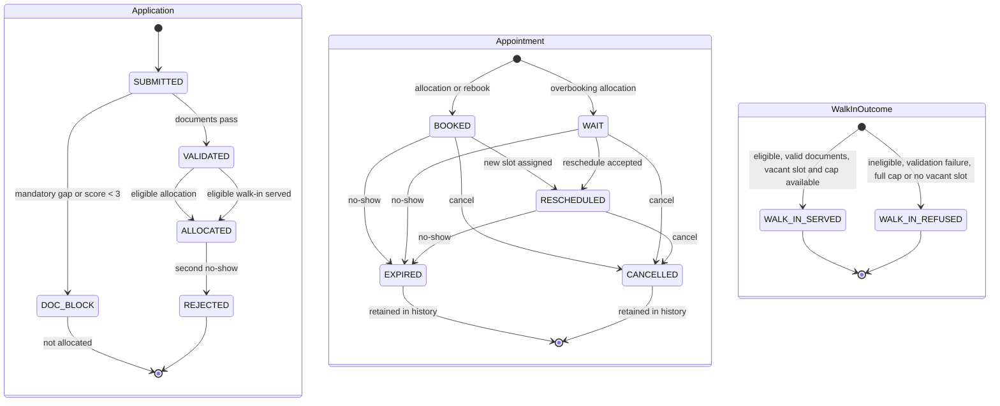

# Appointment State Diagram

Application validation/allocation and appointment lifecycle are separate states in the implementation. A no-show sets the appointment to `EXPIRED`; the second no-show also sets the application to `REJECTED`. Rebooking creates a new appointment record.

`COMPLETED` is declared in `AppointmentStatus`, but the command stream has no attendance/completion command, so no transition to it is shown. Walk-in outcomes are report actions rather than appointment enum values.
